# BookGoal

Dự án đặt sân bóng đá, gồm ba phần: **ứng dụng di động React Native (Expo)** dành cho người chơi, **REST API Node.js/Express + MongoDB** và **trang quản trị React** cho chủ sân.

> Trọng tâm của repository là ứng dụng di động (`mobile/`). Backend và trang admin đóng vai trò hỗ trợ cho ứng dụng.

## Giới thiệu

BookGoal cho phép người chơi xem danh sách sân bóng, xem khung giờ còn trống theo ngày, đặt sân và theo dõi lịch đặt của mình. Phía chủ sân có thể quản lý sân, người dùng, xác nhận/hủy lịch đặt và gửi thông báo qua trang quản trị web.

**Đối tượng sử dụng**
- **Khách hàng:** dùng ứng dụng di động.
- **Quản trị viên (chủ sân):** dùng trang admin trên web.

> **Trạng thái:** dự án đang trong quá trình phát triển, một số phần còn được hoàn thiện (xem [Điểm đang hoàn thiện](#điểm-đang-hoàn-thiện)).

## Tính năng

### Ứng dụng di động (React Native / Expo)

| Nhóm | Chức năng đã triển khai |
|------|-------------------------|
| **Xác thực** | Đăng ký (họ tên, email, số điện thoại, mật khẩu), xác thực tài khoản bằng OTP gửi qua email, đăng nhập bằng email/mật khẩu, quên/đặt lại mật khẩu bằng OTP, đổi mật khẩu |
| **Phiên đăng nhập** | Lưu token bằng `expo-secure-store`, tự động đăng xuất khi token hết hạn |
| **Trang chủ** | Danh sách sân, lịch đặt sắp tới, số thông báo chưa đọc, kéo để làm mới |
| **Sân bóng** | Danh sách sân kèm số khung giờ còn trống trong ngày, tìm kiếm theo từ khóa, lọc theo loại sân (sân 5 / 7 / 11) và khung giờ, chi tiết sân (ảnh, mô tả, bảng giá, mở liên kết bản đồ) |
| **Đặt sân** | Chọn ngày bằng lịch, xem khung giờ đã đặt / còn trống, đặt sân |
| **Lịch đặt** | Xem lịch đặt theo ngày, chi tiết lịch đặt, hủy lịch `pending` ngay lập tức; lịch `confirmed` gửi yêu cầu hủy (`requestCancel`) và có thể rút lại yêu cầu |
| **Thông báo** | Xem thông báo (xác nhận / hủy / hoàn tất lịch đặt, sân mới), đánh dấu đã đọc |
| **Hồ sơ** | Xem thông tin tài khoản, chỉnh sửa tên hiển thị, đổi mật khẩu, đăng xuất |
| **Điều hướng** | Expo Router (file-based), bottom tab tùy chỉnh (Home, Fields, Bookings, Profile) |

### Backend API (Node.js)

- Xác thực **JWT**, phân quyền `user` / `admin` bằng middleware; mật khẩu băm bằng **bcrypt**
- Gửi email OTP bằng **Nodemailer** (Gmail)
- Các module: auth, user, field, booking, notification, thống kê cho admin
- Chống đặt trùng: một khung giờ của một sân trong một ngày không thể đặt hai lần
- Vòng đời booking: `pending` → `confirmed` → `completed`, hoặc `cancelled` / `requestCancel`
- Tự động chuyển booking quá hạn (`pending` → `cancelled`, `confirmed` → `completed`) khi truy vấn và bằng cron job `node-cron` hằng ngày
- Tạo thông báo tự động khi booking đổi trạng thái hoặc có sân mới; thông báo tự hết hạn sau 30 ngày (TTL index)

### Trang quản trị (React)

| Trang | Chức năng |
|-------|-----------|
| **Đăng nhập** | Chỉ chấp nhận tài khoản có quyền `admin` |
| **Dashboard** | Tổng người dùng, tổng booking, tổng sân, doanh thu (từ booking đã hoàn tất), booking gần đây có xác nhận / hủy nhanh |
| **Quản lý sân** | Thêm / sửa / xóa sân, cấu hình giá theo từng khung giờ, tải ảnh sân |
| **Quản lý booking** | Xem tất cả booking, lọc theo trạng thái, xác nhận / hủy / cập nhật trạng thái |
| **Quản lý người dùng** | Tìm kiếm, chỉnh sửa, kích hoạt / vô hiệu hóa, xóa tài khoản |
| **Quản lý thông báo** | Tạo thông báo gửi tới một người dùng hoặc toàn bộ người dùng |

## Công nghệ sử dụng

| Tầng | Công nghệ |
|------|-----------|
| **Mobile** | React Native 0.81, React 19, Expo SDK 54, Expo Router, React Navigation (bottom tabs), Axios, `expo-secure-store`, `jwt-decode`, dayjs / date-fns, `react-native-svg`, `@expo/vector-icons` |
| **Backend** | Node.js (ES modules), Express 5, Mongoose 8, MongoDB, JSON Web Token, bcrypt, Nodemailer, node-cron, `cors`, `dotenv`, `nodemon` |
| **Admin** | React 19, Vite 7, Ant Design 5, React Router 7, Axios, dayjs, ESLint |

## Cấu trúc dự án

```
BookGoal/
├── mobile/                   # Ứng dụng Expo (React Native)
│   ├── app/
│   │   ├── _layout.jsx       # Layout gốc, AuthProvider
│   │   ├── (auth)/           # Đăng nhập, đăng ký, xác thực email, đặt lại mật khẩu
│   │   └── (tabs)/           # Home, field (+ chi tiết), booking (+ chi tiết), profile
│   ├── components/           # Widget dùng lại (FieldCard, BookingCalendar, TimeSlotCard, ...)
│   ├── context/              # AuthContext – quản lý phiên đăng nhập
│   ├── services/             # Tầng gọi API (auth, field, booking, notification)
│   ├── config/api.js         # Axios instance + interceptor gắn JWT
│   ├── hooks/, utils/, constants/
│   └── assets/               # Hình ảnh, style
├── server/                   # REST API Express + MongoDB
│   └── src/
│       ├── app.js, server.js # Khởi tạo ứng dụng
│       ├── config/           # Kết nối MongoDB, cấu hình mailer
│       ├── models/           # User, Field, Booking, Notification, UserNotification
│       ├── controllers/      # Xử lý nghiệp vụ
│       ├── routes/           # Gắn route dưới /api
│       ├── middlewares/      # verifyToken, verifyAdmin
│       └── helpers/          # Tạo thông báo, tự cập nhật booking quá hạn
└── admin/                    # Trang quản trị React
    └── src/
        ├── pages/            # LoginPage, AdminDashboard, pages/admin/* (các trang quản lý)
        ├── services/api.js   # Gọi API bằng Axios
        └── utils/, constants/
```

Ứng dụng mobile tách riêng **màn hình/component**, **tầng service gọi API** và **AuthContext** cho phiên đăng nhập; state cục bộ được quản lý bằng React hooks.

## Giao diện ứng dụng

Ảnh chụp ứng dụng di động trên thiết bị Android (Expo Go), dữ liệu hiển thị là dữ liệu mẫu.

| Đăng nhập | Đăng ký | Trang chủ | Thông báo |
|:---------:|:-------:|:---------:|:---------:|
| 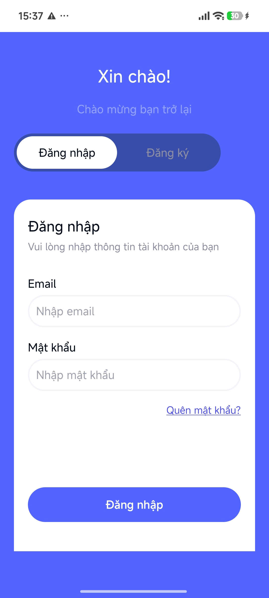 | 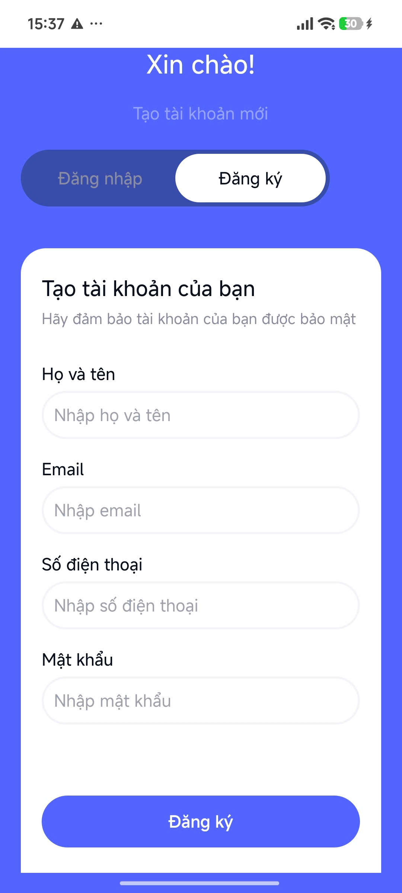 | 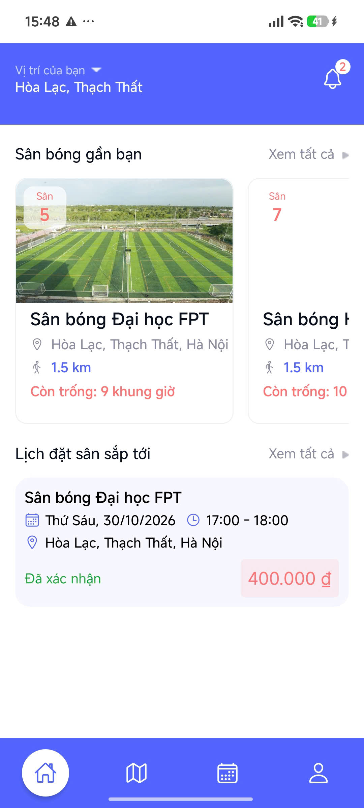 |  |

| Danh sách sân | Bộ lọc loại sân | Chi tiết sân | Chọn ngày |
|:-------------:|:---------------:|:------------:|:---------:|
| 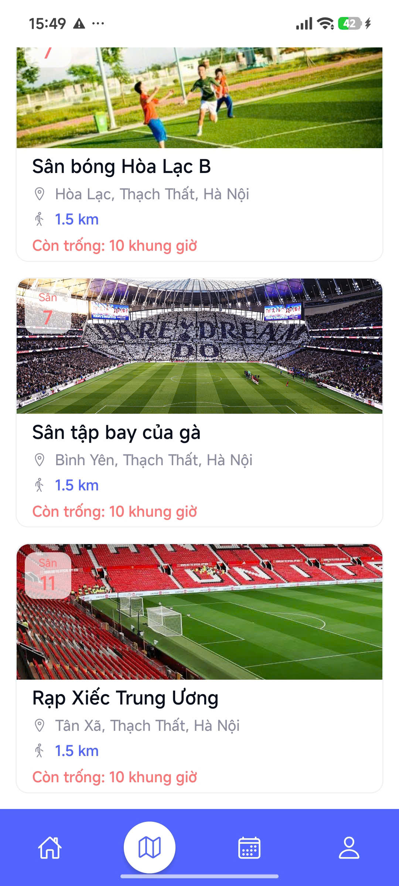 | 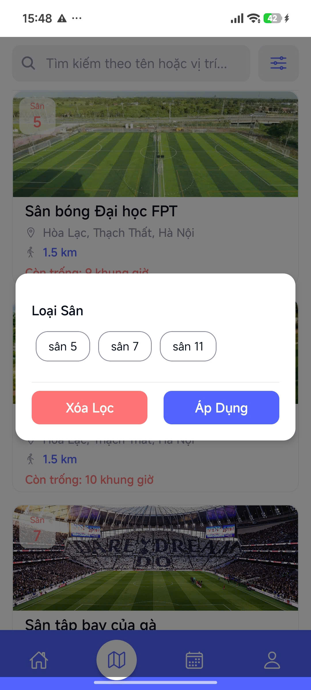 | 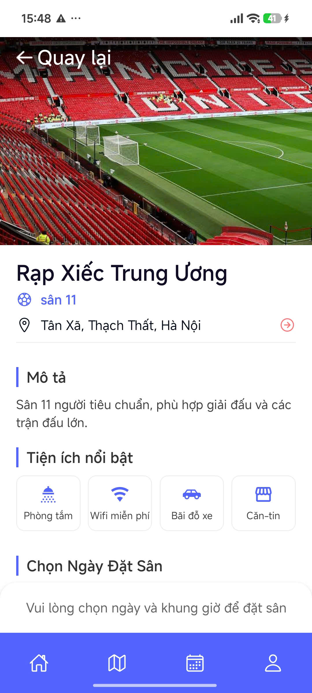 | 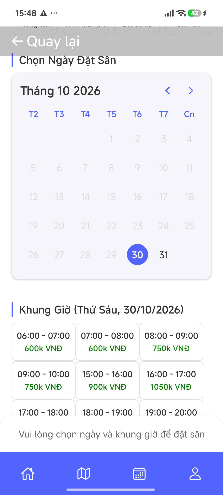 |

| Chọn khung giờ & đặt sân | Lịch sử đặt sân | Chỉnh sửa hồ sơ | Đổi mật khẩu |
|:------------------------:|:---------------:|:---------------:|:------------:|
| 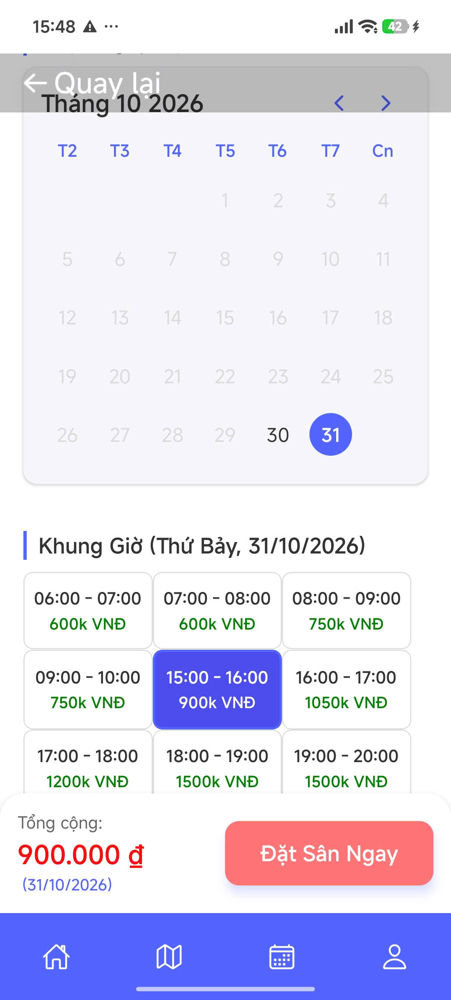 | 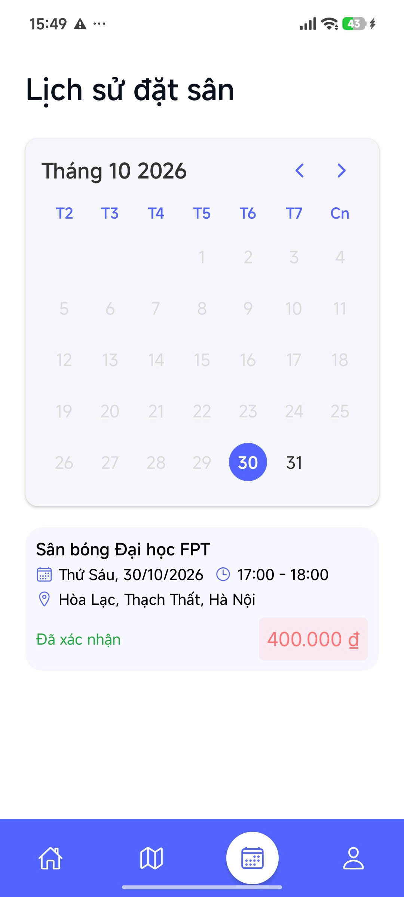 | 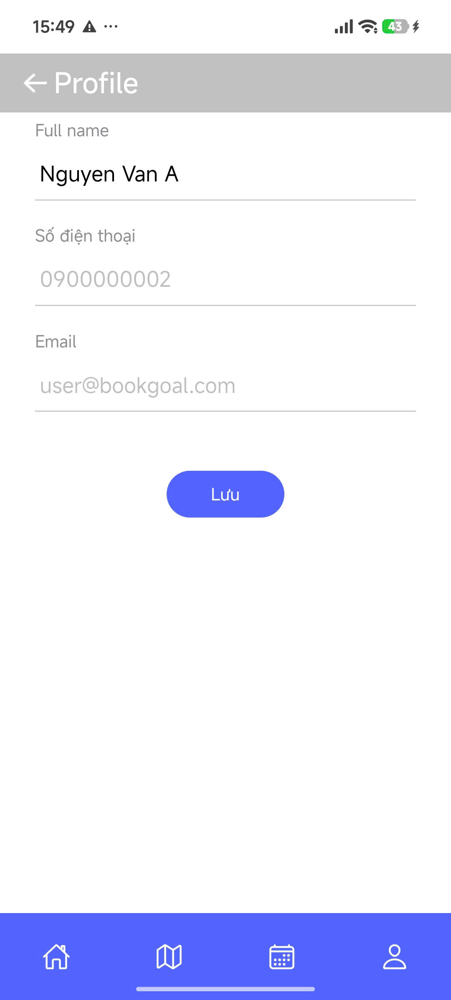 | 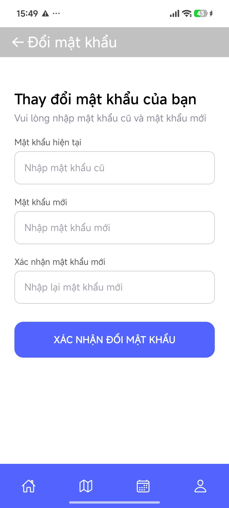 |

> Ảnh trang quản trị (admin) sẽ được bổ sung sau.

## Cài đặt và chạy dự án

### Yêu cầu

- [Node.js](https://nodejs.org/) và npm
- MongoDB (cài local hoặc dùng MongoDB Atlas)
- Tài khoản Gmail có App Password để gửi email OTP
- Android emulator / iOS simulator, hoặc ứng dụng Expo Go trên thiết bị thật

### 1. Chạy backend

```bash
cd server
npm install
```

Tạo file `server/.env`:

```env
PORT=5000
MONGO_URI=<chuỗi kết nối MongoDB>
JWT_SECRET=<chuỗi bí mật bất kỳ>
EMAIL_USER=<địa chỉ Gmail>
EMAIL_PASS=<Gmail App Password>
```

```bash
npm run dev
```

API chạy tại `http://localhost:5000/api`.

> Dự án chưa có script seed. Tài khoản admin cần tạo thủ công: đăng ký tài khoản thường rồi đổi trường `role` thành `admin` trực tiếp trong MongoDB.

### 2. Chạy ứng dụng di động

```bash
cd mobile
npm install
npx expo start
```

Nhấn `a` để mở Android emulator, `i` cho iOS simulator, hoặc quét mã QR bằng Expo Go.

- Địa chỉ API được khai báo trong [mobile/config/api.js](mobile/config/api.js) là `http://10.0.2.2:5000/api` (địa chỉ để Android emulator truy cập máy host). Khi chạy trên thiết bị thật, hãy đổi thành IP LAN của máy tính.
- Cần khởi động backend trước khi mở ứng dụng.

### 3. Chạy trang admin (tùy chọn)

```bash
cd admin
npm install
npm run dev
```

URL API được khai báo cố định trong [admin/src/services/api.js](admin/src/services/api.js) (`http://localhost:5000/api`).

## Điểm đang hoàn thiện

- Màn hình Home hiển thị vị trí và địa chỉ cố định; hook `useUserLocation` đã có nhưng chưa được dùng để tìm sân gần người dùng.
- Đăng xuất chỉ xóa token trên thiết bị; endpoint `/auth/logout` chưa vô hiệu hóa token phía server.
- URL API của mobile và admin đang được ghi cứng trong code, chưa đọc từ biến môi trường.
- Chưa có test tự động.

## Hướng phát triển

Các hạng mục dưới đây **chưa được triển khai**:

- Cấu hình API theo môi trường (`.env`) cho mobile và admin
- Tìm sân gần vị trí người dùng
- Thanh toán trực tuyến cho lịch đặt sân
- Push notification
- Bổ sung unit/integration test cho app và API

## Tác giả

**VinhHV28** — [GitHub](https://github.com/VinHa28)
